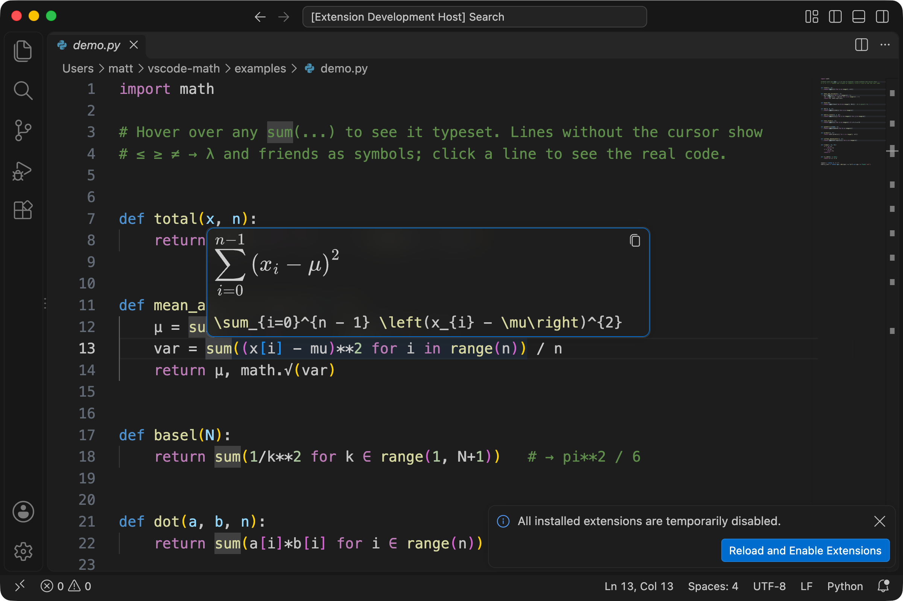

# Math View

A VS Code extension that makes code read more like maths, without changing the file.

- **Sums in the editor:** `sum(x[i] for i in range(1, n+1))` shows as a typeset Σ with its limits stacked above and below. Lines containing a sum are made taller to fit.
- **Symbols:** `<=` `>=` `!=` `->` `lambda` `sqrt` and Greek names show as `≤ ≥ ≠ → λ √ α`.
- **Your cursor's line shows the real code**, so you never edit hidden characters. Tall lines keep their height, so nothing jumps as you move around.
- **Hover** a sum for a bigger version plus its LaTeX, for copying.




## How the tall lines work

VS Code doesn't let extensions set a line's height directly, but colour theme token rules can. The extension adds a grammar scope, `meta.mathview.bigop`, to lines containing a sum, and a default setting that makes that scope's lines 2.4× taller:

```json
"editor.tokenColorCustomizations": {
  "textMateRules": [
    { "scope": "meta.mathview.bigop", "settings": { "lineHeight": 2.4 } }
  ]
}
```

If you already have your own `editor.tokenColorCustomizations`, they replace this default. The extension notices and offers to add the rule for you, or you can switch to compact mode.

## Try it

Open this folder in VS Code and press **F5**. A second window opens on `examples/`, with the extension running. Open `demo.py` or `demo.jl` and hover over a `sum(`.

To install it in your everyday VS Code:

```bash
npm run package
```

```bash
code --install-extension vscode-math-0.1.0.vsix
```

## What the hover understands

Python and Julia generator sums and products:

| Code | Shown as |
|---|---|
| `sum(x[i] for i in range(1, n+1))` | Σ from i=1 to n of xᵢ |
| `sum(x[i] for i in range(n))` | Σ from i=0 to n−1 |
| `sum(x[i] for i in 1:n)` (Julia) | Σ from i=1 to n |
| `sum(A[i][j] for i in range(n) for j in range(m))` | double sum |
| `sum(x[i] for i in range(n) if i % 2 == 0)` | condition under the Σ |
| `sum(w for w in weights)` | Σ over w ∈ weights |
| `math.prod(...)`, `np.sum(...)` | Π, Σ |

Inside the sum it handles `+ - * / // % **`, indexing (`x[i]` → xᵢ), `sqrt`, `abs`, `exp`, `log`, trig functions and Greek variable names. Anything outside that, such as strings or list comprehensions, simply gets no hover.

## Settings

| Setting | Default | |
|---|---|---|
| `mathView.enabled` | `true` | Symbol substitution on or off. Also **Math View: Toggle Symbol Substitution** in the command palette. |
| `mathView.revealOnCursorLine` | `true` | Show the original text on lines with a cursor. |
| `mathView.inline` | `tall` | `tall`: full stacked Σ in a taller line. `compact`: limits beside the Σ, normal line height. `off`: leave sums as code. |
| `mathView.hover` | `true` | Typeset sums on hover. |
| `mathView.hoverScale` | `1.4` | Size of the hover maths. |
| `mathView.substitutions` | see `package.json` | List of `{ "pattern", "symbol", "languages"? }`. `pattern` is a JavaScript regex. |

Adding your own symbol, for example `**` as a superscript-style `^` in Python only:

```json
"mathView.substitutions": [
  { "pattern": "\\*\\*", "symbol": "^", "languages": ["python"] }
]
```

Setting this list replaces the defaults, so copy the ones you want to keep from `package.json`.

## Limitations

- Substitutions are plain pattern matches, so they also apply inside strings and comments.
- Tall lines work for Python and Julia, the languages the grammar rule is attached to. Sums split over several lines stay as code.
- Line height follows the grammar's simple pattern match, so a line with a sum the extension can't typeset (for example one using strings) still gets taller.
- The colour of the hover maths follows light/dark theme, not the exact theme colour.

## Development

```bash
npm test
```

```bash
npm run test:vscode
```

`npm test` runs the parser tests. `npm run test:vscode` runs the extension inside your installed VS Code with a throwaway profile and checks the hovers.

Files: `extension.js` (decorations, hover), `src/latex.js` (code → LaTeX), `src/render.js` (LaTeX → SVG via MathJax).
