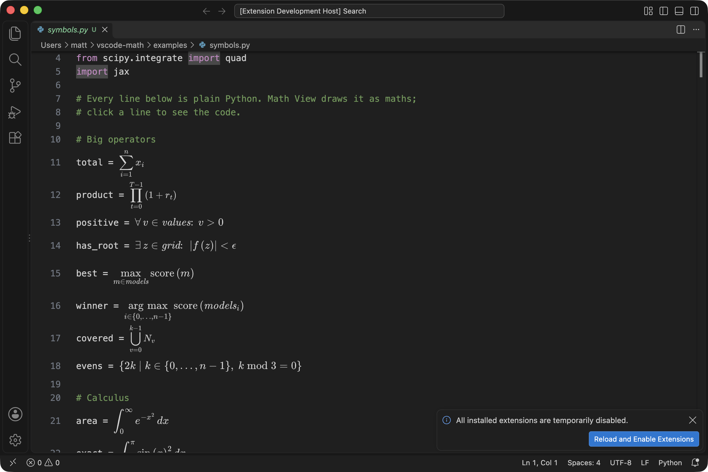
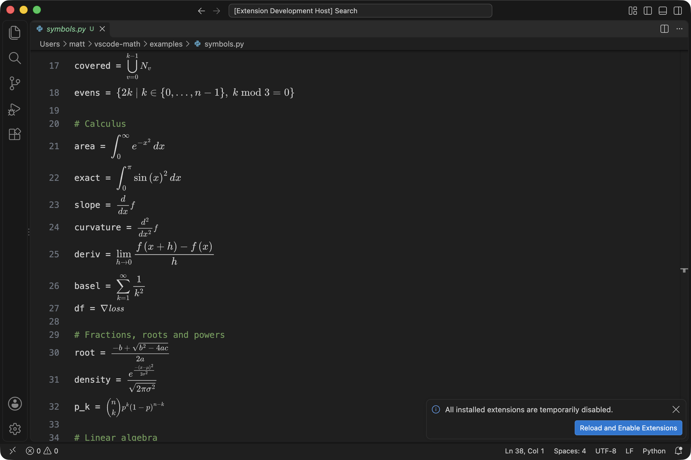

# Math View

A VS Code extension that makes code read like maths, without changing the file.

- **Maths in the editor:** sums, products, integrals, limits, derivatives, fractions, roots, matrices, piecewise cases, ∀/∃, argmax and set-builder notation are drawn typeset, right where the code is. Lines that need room are made taller.
- **Symbols:** `<=` `>=` `!=` `->` `lambda` `sqrt` and Greek names show as `≤ ≥ ≠ → λ √ α`.
- **Your cursor's line shows the real code**, so you never edit hidden characters. Tall lines keep their height, so nothing jumps as you move around.
- **Hover** any drawn maths for a bigger version plus its LaTeX, for copying.
- **Config driven:** everything it knows is in notation tables you can extend per language and per project.





## What it draws

Python (with NumPy, SciPy, SymPy, JAX and PyTorch names) and Julia. A line is drawn when it contains notation like the examples below; plain code such as `x = y + 2 * z` stays as it is.

| Code | Drawn as |
|---|---|
| `sum(x[i] for i in range(1, n+1))` | Σᵢ₌₁ⁿ xᵢ |
| `math.prod(1 + r[t] for t in range(T))` | ∏ₜ₌₀^{T−1} (1 + rₜ) |
| `all(v > 0 for v in values)`, `any(...)` | ∀ v ∈ values: v > 0, ∃ … |
| `max(f(x) for x in S)`, `min(...)` | max over x ∈ S of f(x) |
| `max(range(n), key=lambda i: f(i))` | argmax over i ∈ {0, …, n−1} of f(i) |
| `set().union(*(A[i] for i in range(n)))` | ⋃ᵢ Aᵢ (and ⋂ for intersection) |
| `{f(x) for x in S if p(x)}` | {f(x) \| x ∈ S, p(x)} |
| `quad(lambda x: f(x), a, b)[0]` | ∫ₐᵇ f(x) dx |
| `sympy.integrate(f, (x, a, b))` | ∫ₐᵇ f dx |
| `sympy.diff(f, x)`, `sympy.diff(f, x, 2)` | d/dx f, d²/dx² f |
| `sympy.limit(expr, x, 0)` | lim_{x→0} expr |
| `sympy.Sum(1/k**2, (k, 1, oo))` | Σ_{k=1}^∞ 1/k² |
| `jax.grad(f)` | ∇f |
| `(-b + math.sqrt(b**2 - 4*a*c)) / (2*a)` | the quadratic formula as a fraction |
| `math.comb(n, k)`, `n // 2` | binomial, ⌊n/2⌋ |
| `np.linalg.inv(A.T @ A) @ A.T @ y` | (AᵀA)⁻¹Aᵀy |
| `np.linalg.norm(v)`, `np.dot(a, b)`, `np.cross(a, b)` | ‖v‖, a·b, a×b |
| `np.array([[1, 2], [3, 4]])` (also over several lines) | a bracketed matrix |
| `x if x > 0 else 0`, `np.where(c, a, b)` | a piecewise { with cases |
| `np.mean(x)`, `np.std(x)`, `np.var(x)` | x̄, σₓ, Var(x) |
| `x_hat`, `x_bar`, `v_vec`, `f_prime`, `e1` | x̂, x̄, v⃗, f′, e₁ |
| Julia: `quadgk(x -> x^2, 0, 1)[1]`, `A'`, `√x`, `a ⋅ b`, `c ? a : b` | ∫, Aᵀ, √x, a·b, cases |

See [`examples/symbols.py`](examples/symbols.py) for all of them in one file.

Expressions are drawn whole where possible: the right-hand side of an assignment, a `return` value, an `if` condition. Inside something that isn't maths, such as `print(...)` or a tuple, only the maths parts are drawn.

## How the tall lines work

VS Code doesn't let extensions set a line's height directly, but colour theme token rules can. The extension adds grammar scopes to lines that need room, `meta.mathview.tall` (Σ, ∫, lim, matrices, cases) and `meta.mathview.medium` (fractions, binomials, ∀/∃), and default settings that make those lines taller:

```json
"editor.tokenColorCustomizations": {
  "textMateRules": [
    { "scope": "meta.mathview.tall", "settings": { "lineHeight": 2.4 } },
    { "scope": "meta.mathview.medium", "settings": { "lineHeight": 1.7 } }
  ]
}
```

Maths written over several lines, like a matrix, is drawn across those lines instead.

If you already have your own `editor.tokenColorCustomizations`, they replace this default. The extension notices and offers to add the rule for you, or you can switch to compact mode.

## Try it

Open this folder in VS Code and press **F5**. A second window opens on `examples/`, with the extension running. Open `symbols.py` to see every kind of notation, or `demo.py` and `demo.jl`. Hover over drawn maths for a bigger version.

To install it in your everyday VS Code:

```bash
npm run package
```

```bash
code --install-extension vscode-math-0.1.0.vsix
```

## Settings

| Setting | Default | |
|---|---|---|
| `mathView.enabled` | `true` | Symbol substitution on or off. Also **Math View: Toggle Symbol Substitution** in the command palette. |
| `mathView.revealOnCursorLine` | `true` | Show the original text on lines with a cursor. |
| `mathView.inline` | `tall` | `tall`: draw maths full size, making lines taller where needed. `compact`: fit everything in a normal line. `off`: leave code as it is (hovers still work). |
| `mathView.hover` | `true` | Show drawn maths larger on hover, with its LaTeX. |
| `mathView.hoverScale` | `1.4` | Size of the hover maths. |

## Notation is config driven

Everything the extension knows about maths lives in tables: which calls are big operators, how functions are drawn, which names are symbols, and what counts as a range. The built-in tables are in [`src/notation/`](src/notation). Your settings are merged on top of them:

| Setting | What it holds |
|---|---|
| `mathView.bigOperators` | Calls with a generator, e.g. `sum(f(i) for i in ...)`, and their LaTeX symbol |
| `mathView.functions` | LaTeX templates for function calls |
| `mathView.identifiers` | Names and constants drawn as LaTeX |
| `mathView.ranges` | Iterables that become the limits of a sum |
| `mathView.syntax` | Operators and syntax: `fraction`, `floorDiv`, `matmul`, `piecewise`, `setComprehension`, `listComprehension`, `lambda`, `adjoint` |
| `mathView.nameSuffixes` | Name endings drawn as accents: `_hat` → x̂ |
| `mathView.modulePrefixes` | Module names ignored in lookups, so `np.sqrt` uses `sqrt` |
| `mathView.symbols` | Symbol substitutions: regex → symbol |
| `mathView.builtinNotation`, `mathView.builtinSymbols` | Turn off to start from empty tables |

Run **Math View: Show Notation for This Language** to see the merged tables for the file you're in.

Rules for all of them:

- **Merging:** your entries are added to the built-ins, or replace one with the same key. Set a key to `null` to remove a built-in. For `modulePrefixes`, start an entry with `-` to remove one.
- **Per language:** every setting works inside VS Code's language blocks, so Python and Julia can differ.
- **Per project:** put them in `.vscode/settings.json` to give a repo its own notation.

An example that adds a little of everything:

```jsonc
"[python]": {
  "mathView.bigOperators": {
    "logsumexp": "\\operatorname{LSE}"          // logsumexp(z[i] for i in range(k))
  },
  "mathView.functions": {
    "softplus": "\\log\\left(1 + e^{$1}\\right)",
    "hypot/2": "\\sqrt{$1^2 + $2^2}",             // name/arity matches by number of arguments
    "clip": [                                     // a list is tried in order
      "\\operatorname{clip}_{[$2, $3]}($1)",
      "\\operatorname{clip}($1)"
    ]
  },
  "mathView.identifiers": { "hbar": "\\hbar" },
  "mathView.ranges": {
    "arange/2": { "from": "$1", "to": "$2 - 1" }  // written in Python, then simplified
  },
  "mathView.symbols": { "\\*\\*": "^", "!=": null }
}
```

Template placeholders:

| Placeholder | Meaning |
|---|---|
| `$1`, `$2` | arguments, converted to LaTeX |
| `$args` | all arguments, comma separated |
| `$0` | the object a method is called on: `A.dot(B)` |
| `$key` | a keyword argument: `max(S, key=...)` |
| `$1.var`, `$1.body` | a lambda argument's parameters and body |
| `$2.0` | an item of a tuple argument: `integrate(f, (x, a, b))` |
| `$1\|atom` | brackets the argument unless it's a single symbol |
| `$1\|rows` | a list of lists as matrix rows |
| `$1\|domain` | `range(n)` as {0, …, n−1} |

Big operator templates get `$body`, `$vars`, `$domain`, `$conds`, `$in` (x ∈ S, conditions), `$under` and `$over`.

Table keys: `name`, `name/arity` (number of arguments), `name[keyword]` (called with that keyword argument), `.method` and `.attribute` (like `.T`).

An entry can be an object with options: `{ "template": "...", "height": "tall", "display": false }`. `height` (`tall` or `medium`) makes lines with it taller; `display: false` means it's drawn inside other maths but doesn't make a line draw on its own, which is how `sin` and `max(a, b)` stay as code.

Range limits (`from`, `to`) are written in the document's language rather than LaTeX, so `range(1, n+1)` gets an upper limit of `n`, not `n + 1 - 1`.

Changing `bigOperators`, `functions` or `syntax` can also change which lines are made taller. VS Code only reads that grammar at startup, so the extension rewrites it and offers to reload the window.

## Limitations

- Symbol substitutions are plain pattern matches, so they also apply inside strings and comments.
- Python and Julia only for now.
- Line heights come from simple per-line patterns, so occasionally a line is made taller than it needs, or maths is scaled down to fit. Two fractions on one line count as tall.
- Julia matrix literals like `[1 2; 3 4]` aren't drawn yet.
- When a file is opened already scrolled down, VS Code can show the wrong line numbers in the gutter until you scroll once. This is VS Code not redrawing the gutter after line heights change.
- The colour of the maths follows light/dark theme, not the exact theme colour.

## Development

```bash
npm test
```

```bash
npm run test:vscode
```

`npm test` runs the parser tests. `npm run test:vscode` runs the extension inside your installed VS Code with a throwaway profile and checks the hovers.

Files:

- `extension.js`: decorations, hover, settings
- `src/notation/`: built-in notation tables per language
- `src/parse/`: expression parsers
- `src/scan.js`: finds the expressions in a document (assignments, returns, conditions), skipping strings and comments
- `src/select.js`: picks the pieces worth drawing
- `src/tex.js`: parsed code → LaTeX, driven by a notation
- `src/grammar.js`: generates the tall-line grammars in `syntaxes/` (`npm run grammars` after changing the built-ins)
- `src/render.js`: LaTeX → SVG via MathJax
